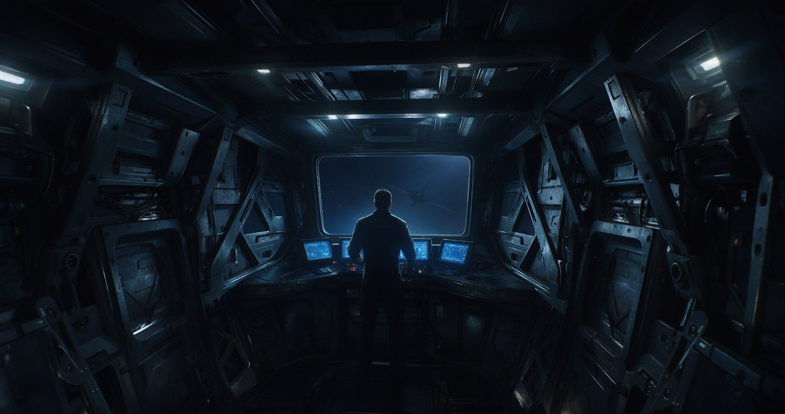

# 星海舵手 · Starsea Helm

[简体中文](README.md) | [English](README.en.md)

> First-person bridge-based defense + wave survival. **You have only one window — the one in front.**
> The other five sides are solid bulkheads, so you have to rely on monitor screens and your ears to work out who is attacking from behind.

<p align="center">
  
  <br>
  <em>Concept placeholder image (AI-generated). The project does not yet have final art; this is the visual direction we are aiming for.</em>
</p>

---

## What is this?

A 3D first-person space bridge game made with Godot 4. You do not pilot the ship or roam a map — **you sit on the bridge as its captain**,
using these core actions to get through an entire run: fit out / take control / scan.

| | |
|---|---|
| **Genre** | Bridge-based defense + wave survival (not tower defense, not an FPS) |
| **Core loop** | Fit out → fight → **adjust your loadout** → fight |
| **Unit of progression** | **Crisis** (not a “run”) |
| **Rendering** | Godot 4.7 · Forward+ (Vulkan) |

### Three things that set this project apart

1. **A small innovation: only one window, at the bow.**
   Information asymmetry is not imposed by UI restrictions; it is **physically guaranteed** — turn your head and all you see is a wall.
   Four live secondary-gun feeds (low resolution, low frame rate) stay on the console, in your **lower peripheral vision** when looking straight through the window,
   so you can read the situation without turning away from the battlefield.

2. **The failure mode is not “the player does nothing”; it is “decisions do not matter.”**
   Combat is deliberately low-APM; an idle-game feel is a **design goal**, not a flaw.
   The criterion is strict: a carefully chosen loadout must survive at least 3 more crises than a random one. Anything less means the design is broken.

3. **No currency, no shop.**
   New gun types and slots **unlock automatically** as crises progress, with the unlock cadence matched to the threat curve.
   Your resource is not money but **battle damage** — whichever side was battered in the last wave determines how you fit out for this one.

---

## Current progress

P0 = without it, this would not be this game. Only two P0 items remain:

| Status | Content |
|---|---|
| ✅ Complete | Whitebox bridge / six sectors and threat calculations / main gun + four-direction secondary guns / faster firing under manual control / turret durability and all-destroyed detection / wave scheduling / monitor feeds / refit phase / automatic unlocks / battle damage report / collapse sequence / audio framework / first layer of game feel (white flash · screen shake · camera push-in · health feedback) |
| 🟡 In progress | Fifth layer of game feel (VFX) · hitstop |
| ⏸ Frozen | Connecting monitor screens to actual secondary-gun viewpoints — waiting for art models; to be enabled together with the 3D presentation version |
| ⬜ Next | **Art asset plan** — replacement order: compartment → console → enemies → turrets → VFX |

> See [`docs/BACKLOG.md`](docs/BACKLOG.md) for the full list (four priority levels: P0/P1/P2/P3).

---

## How this project is made

The code repository alone does not say much — anyone can get AI to generate a Godot project.
**The real experiment here is whether engineering discipline can turn AI from a “code generator” into an “accountable collaborator.”**

### A three-round conversation rhythm

Most AI collaboration failures happen because the first round is skipped and code is requested straight away.

| Round | What the human does | What AI does | Prohibited |
|---|---|---|---|
| **Round 1** | State the task clearly | **Only restate its understanding + propose an approach** | ❌ No writing code |
| **Round 2** | **Only answer the questions AI raised** | Confirm the details of the approach | ❌ No adding new ideas |
| **Round 3** | Say “start implementing” | Implement + self-test | ❌ No changing requirements midway |

### Five non-negotiable rules

1. **Without a Bible, you cannot use AI** — design changes must be reflected in the documentation.
2. **Have AI explain its approach before letting it write code.**
3. **Change only one thing at a time**; self-test before moving on to the next.
4. **Externalize parameters to JSON; AI provides “knobs,” not “values.”**
5. **AI helps prioritize, but the human makes the final call.**

### Decision register

Every design decision has an ID, a rationale, **and explicit “conditions for overturning it”** —
see [`docs/bible/99_decisions.md`](docs/bible/99_decisions.md). A few examples:

| ID | Decision | Why |
|---|---|---|
| DEC-026 | The bridge has only one window, at the bow | With glass on four sides, players could turn and look behind them → monitors would become pointless → the small innovation would collapse |
| DEC-021 | Failure mode = decisions do not matter | Low APM is the goal; the problem to prevent is “careful and random loadouts make no difference” |
| DEC-025 | Derive unit scale from constraints, rather than guessing | The window's field of view is calculated geometrically, not a parameter tuned by hand |
| DEC-033 | No currency / automatic unlocks | The resource is battle damage, not money |
| DEC-047 | Game feel uses “event → intensity table” | Automatic weapons fire every frame; feedback on every hit would mean continuous twitching |

**This table records something AI cannot write on its own** — where the human made the final call, why, and under what conditions the conclusion would no longer hold.

### Numerical tuning: knobs, not final values

All tunable values are externalized in [`data/`](data/) (6 JSON files): `presentation.json` (presentation and game feel), `enemies.json`,
`turrets.json`, `waves.json`, `refit.json`, and `audio.json`.
Changing game feel, difficulty, or sound effects **does not require touching a single line of code**.

---

## Engineering evidence

### Tests: 11 headless scene suites / 408 assertions, all passing

All can run headlessly, without art assets.

| Suite | Coverage | Assertions |
|---|---|---:|
| `feel_test` | Game-feel knobs / exact camera push-in reset / screen-shake cap / white-flash cooldown | 49 |
| `audio_test` | Bus hierarchy / synthesized-sound fallback for missing assets / rate-limit keys include sector / auditory HUD | 60 |
| `healthbar_test` | Health source of truth / layer indices / dimming does not suppress white flashes / health-bar target switching | 43 |
| `unlock_test` | Initial locks / crisis-based unlocks / installing guns in empty slots | 77 |
| `damage_test` | Battle damage accumulation / breakdown by enemy type / sector summaries / four outputs share one source | 37 |
| `refit_test` | Refit phase state machine / loadout changes actually take effect / skipping while hidden / rejecting unknown models | 33 |
| `turret_hp_test` | Damage routing / destroyed turrets stop firing / all-destroyed event / destroyed guns cannot be taken over | 30 |
| `wave_test` | Difficulty curve / spawning at wave start / returning to REFIT after clearing / resetting to zero in RESULT | 25 |
| `turret_round2` | Four secondary guns fire independently / gun-position derivation / end-to-end kills | 21 |
| `collapse_test` | Three-stage collapse sequence / revoking control and entering RESULT / presentation-layer fault tolerance | 18 |
| `enemy_test` | Enemy spawning / movement / sector assignment / attacking the nearest turret | 15 |
| **Total** | | **408** |

```bash
# Run one suite (requires an imported project, i.e. an existing .godot/)
godot --headless --path . res://scenes/tests/feel_test.tscn

# Run all suites
for s in feel_test audio_test healthbar_test turret_round2 turret_hp_test \
         enemy_test wave_test refit_test unlock_test damage_test collapse_test; do
  printf "%-16s " "$s"
  godot --headless --path . "res://scenes/tests/$s.tscn" 2>&1 | grep -E "断言:|结果：" | head -1
done
```

> In headless mode, the main scene consistently prints `texture_2d_get: Parameter "t" is null` —
> this is an inherent limitation of the dummy rendering driver, where the backend RID of `SubViewport.get_texture()` is null, **not something caused by your changes**.

### Three engineering rules (all backed by tools, not just self-discipline)

- **Run it after making changes to confirm they work** — do not report success based on “I thought I changed it.” Rendering / feed issues always require actual **pixel sampling**, not visual judgment.
- **Tests follow real call paths, with no shortcuts** — apply damage through `Turret.take_damage` rather than directly calling `emit`. A direct `emit` skips `source_id` propagation, so **tests stay green even when it is broken**.
- **Clear the scene between phases** — counting enemies before `call_deferred queue_free` takes effect includes corpses from the previous wave.

---

## Repository structure

```
scripts/     35 GDScript files (about 10,400 lines) — including headless probes under systems/ and tests/
scenes/      14 scenes · bridge/ is the main scene; tests/ contains test scenes
data/        6 external tuning JSON files — knobs, not final values
docs/        bible/ (constitution-like constraints + DEC decision register) and development guidance
.workbuddy/  AI collaboration memory: daily milestones / decision chains / lessons from pitfalls
```

### About `.workbuddy/`

This directory is **deliberately included in the repository**.

It contains AI's daily work records, pitfalls encountered, and the decision chain at every step — the part of “AI collaboration” you cannot see in the code.
If you want to understand “how AI actually participated in this project,” start with
[`.workbuddy/memory/history.md`](.workbuddy/memory/history.md).

---

## Running the project

```bash
git clone https://github.com/Lijiahong77/Starsea-Helm.git
```

Open `project.godot` with **Godot 4.7** (the standard edition, not `.NET`).
The project path **contains a space** (`Starsea Helm`) — if the MCP toolchain has problems, first check whether the space is the cause.

> ⚠ This project is **under development**: whitebox scenes, art assets not yet replaced, and an essentially empty `assets/` directory.
> Most functionality needs to be verified through the headless test suites; this is not a ready-to-play game out of the box.

**Language scope:** Only the README is translated into English here. The in-game UI and linked development documents remain in Chinese; it does not indicate an English-localized game. The Godot version, progress, and test results above are those reported in the original Chinese README, not independently verified by running the project for this translation.

---

## Documentation guide

| To learn about | Read |
|---|---|
| What the game is / is not | [`docs/SPEC.md`](docs/SPEC.md) |
| Feature list and priorities | [`docs/BACKLOG.md`](docs/BACKLOG.md) |
| Design decisions and rationale | [`docs/bible/99_decisions.md`](docs/bible/99_decisions.md) |
| System module boundaries | [`docs/MODULES.md`](docs/MODULES.md) |
| How to use the three core documents | [`docs/bible/_index.md`](docs/bible/_index.md) |
| Development process and non-negotiable collaboration rules | [`docs/PROCESS.md`](docs/PROCESS.md) |
| Daily records of AI collaboration | [`.workbuddy/memory/history.md`](.workbuddy/memory/history.md) |

---

## Notes

- This is a **personal, independently developed experimental project**, licensed under **All Rights Reserved**:
  reading and cloning for learning are permitted; **redistribution, commercial use, publishing modified versions, and use for training AI models are not permitted**. See [`LICENSE`](LICENSE) for details.
- The concept image was AI-generated (豆包 Doubao) and serves only as a placeholder for the visual direction; it is not an in-game screenshot.
